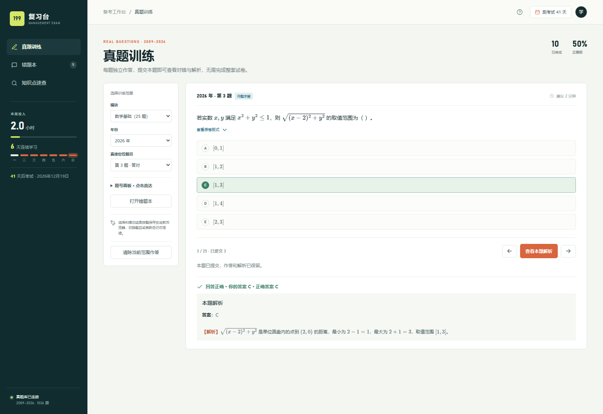
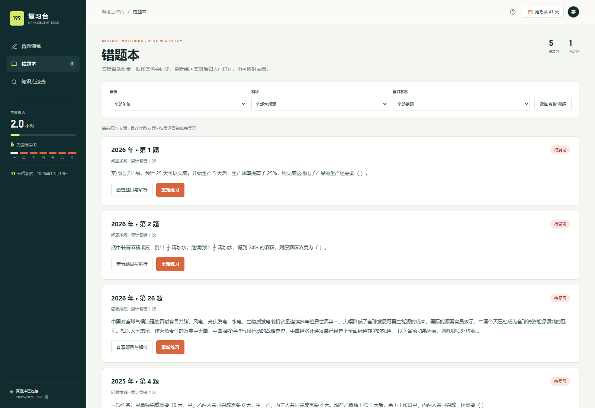
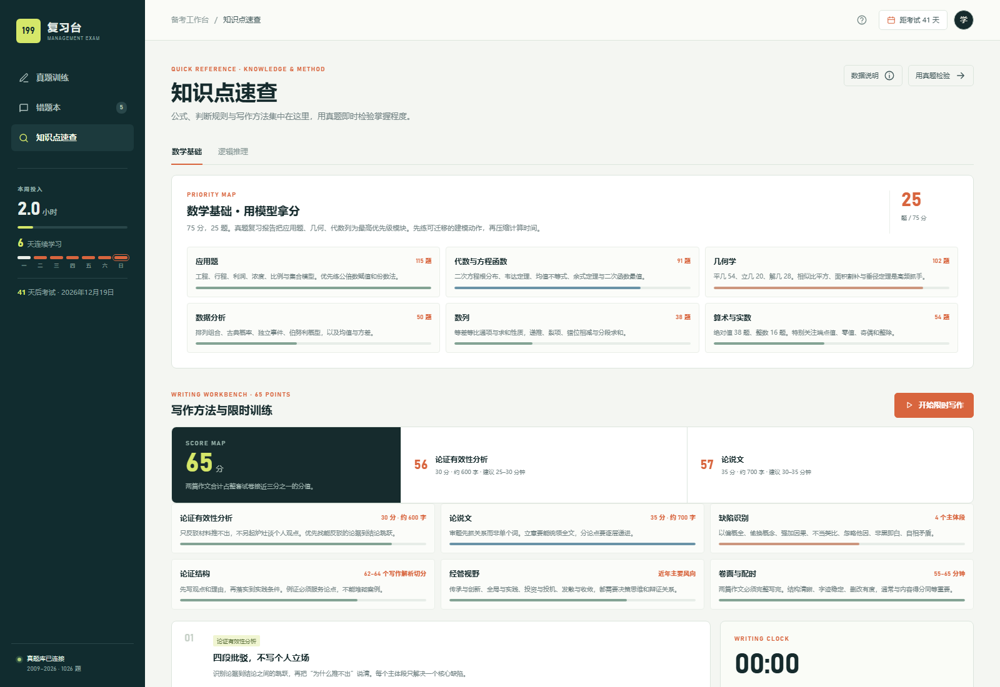
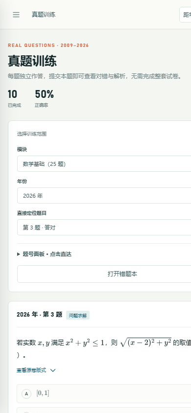

# 考研管综 199 真题题库(2009–2026)

199 管综历年真题(试卷 + 答案解析)的结构化 Markdown 题库 + RAG 切分库(JSONL),
附可本地运行的浏览器复习台。每年一卷、57 题,每题附原卷切片图。
2009–2026 共 18 年、1026 题,各卷 md 已逐题人工/多模态校核,
**md 是本题库的唯一内容源**。

复习台共三页:**真题训练**(逐题作答、直接定位题目)、**错题本**(自动收录、筛选与重做订正)、
**知识点速查**(知识卡、公式速查、写作方法与限时训练),纯前端、无需安装依赖。

## 本地复习台

### 快速启动

在仓库根目录执行(建议使用 Python 3.11):

```bash
python study-guide/serve.py 8765
```

浏览器打开 **[199 复习台](http://127.0.0.1:8765/study-guide/index.html)**。
服务仅监听本机 `127.0.0.1`,终端保持运行,按 `Ctrl+C` 停止;
端口被占用时可将命令和访问地址中的 `8765` 一起改为其他端口。

运行复习台只需 Python 标准库和现代浏览器,无需安装 Node.js、OCR 或前端构建依赖。
服务以整个仓库为站点根目录,才能访问 `study-guide/` 之外的原卷切片图;
不要只用 `study-guide/` 作为 HTTP 根目录。修改页面后刷新即可,本地服务已禁用缓存。
数学公式使用 CDN 加载 MathJax,首次访问需联网,无法加载时可能显示 LaTeX 原文。

### 界面截图

以下截图取自本地运行的复习台,题库与学习记录为真实数据。

**真题训练**:逐题作答,提交后立即给出对错、正确答案与本题解析。



**错题本**:答错的题目自动收录,按年份、模块与掌握状态筛选,可直接重做。



**知识点速查**:知识卡、公式速查、写作方法与限时训练集中在一页。



**手机端**:窄屏下侧栏折叠为抽屉菜单,横向无溢出,手机上同样可用。



### 功能与使用

复习台共三页:**真题训练**、**错题本**、**知识点速查**,默认落地页是真题训练。

- **逐题提交与解析**:数学、逻辑及整卷客观题均可独立选择和提交,立即查看对错、正确答案与本题解析,无需完成整卷。支持查看原卷切片及 SVG 图形。
- **直接定位题目**:选择年份和模块,用“直接定位题目”下拉框或展开“题号面板”跳转,不必连续点击下一题。面板标明未作答、待提交、答对、答错和重做状态;题号采用原卷编号。
- **错题本**:答错自动收录,此前保存的错误作答也会导入。可按年份、模块及“待复习 / 已订正 / 全部错题”筛选,直接查看题目与解析或重新练习。
- **错题重做与订正**:重新练习时隐藏旧答案和解析,提交前保留上次记录;答对后归入“已订正”,答错则继续待复习并累计错误次数,同一道题不会重复建卡。已订正题仍可回看、再练。
- **知识点速查**:数学与逻辑的优先级地图、可筛选知识卡(核心 / 拓展,附 PDF 页码)和高频公式速查表;写作方法、限时计时器与全文自查清单也并入本页。写作部分不提供自动评分。
- **写作题入口**:在“知识点速查”的近年写作题风向卡片中点“读取原题”,或在真题训练里把模块切到“综合写作(2 篇)”,可直接查看第 56、57 题原文与参考立意。

客观题训练范围为每年 **第 1–55 题**:数学第 1–25 题,逻辑第 26–55 题;
其中第 16–25 题使用各年份原文的条件充分性判断选项。18 年共 990 道客观题;
第 56、57 题为写作题,不纳入选择题提交、题号面板的作答状态和错题本,只读原文与参考立意。

**记录保存与清除**:

- 选择草稿、已提交作答、重做状态及当前训练位置保存在当前浏览器的 `localStorage`,切题或刷新后可继续;错题本筛选也会保留。重做中回看旧解析只暂停练习,不丢弃草稿;“取消本次重做”会删除该次草稿。
- “清除当前范围作答”会同时删除当前年份、当前模块的作答、草稿、错题及订正记录,不影响其他范围。已完成题数按不同题目计数,重做不会增加题目数,正确率使用最新提交结果。
- 记录没有云端同步或备份;清除浏览器站点数据会丢失记录。请固定使用同一浏览器、主机名和端口,切换浏览器、`localhost`/`127.0.0.1` 或端口不会共享记录。

### 使用方法

按下面四步即可开始一轮练习,中途随时关闭浏览器,下次打开会接着上次的位置。

**第一步:选范围**。左侧"选择训练范围"里先选模块,再选年份。

| 模块 | 覆盖题号 | 题量 |
| --- | --- | --- |
| 数学基础 | 第 1~25 题 | 25 |
| 逻辑推理 | 第 26~55 题 | 30 |
| 完整客观题 | 第 1~55 题 | 55 |
| 综合写作 | 第 56、57 题 | 2 |

年份可选 2009–2026 共 18 年。选好后右侧会显示该范围内的第一道未作答题。

**第二步:作答**。读题后点选项 A–E,再点"提交本题并查看解析"。提交后立刻显示:

- 对错判定与正确答案(答错时用红色标出你的选择与正确选项)
- 本题解析,公式由 MathJax 渲染
- 顶部"已完成"与"正确率"实时更新

每题独立提交,不必做完整套卷。答错会自动进入错题本。

**第三步:定位题目**。不想一题一题往下点时,用左侧两个入口:

- "直接定位题目"下拉框:选年份和模块后直接跳到指定题号
- "题号面板":展开后是整卷的题号网格,点击任意题号即可跳转

面板上每个题号都带状态标记:未作答、待提交、答对、答错、重做中。

**第四步:复盘错题**。切到"错题本",用顶部三个下拉框按年份、模块和掌握状态筛选。

- "待复习":还没订正的错题
- "已订正":重做答对后的题,仍可回看、再练
- "全部错题":两者合看

每条错题有两个按钮:"查看题目与解析"直接回看,"重新练习"进入重做模式。重做时旧答案和解析会隐藏,提交前的选择会先记为草稿;答对归入"已订正",答错则继续留在"待复习"并累计错误次数。同一道题不会重复建卡。

**知识点速查**页用于考前突击,分"数学基础"和"逻辑推理"两个标签:

- 优先级地图:按题量排序列出各模块,先看题多的模块
- 知识卡:可按"核心 / 拓展"筛选,每张卡标注了教材 PDF 页码
- 高频公式速查表:条件充分性判断、概率、排列组合等必背公式
- 写作方法与限时训练:写作配时表、四大重点模块、写作自查清单,另有"开始限时写作"计时器

写作部分**不提供自动评分**,只给结构和要点提示;要练写作题,用速查页"近年写作题风向"卡片里的"读取原题",或把真题训练的模块切到"综合写作",直接看第 56、57 题原文与参考立意。

### 更新复习台题库

启动时直接读取现有的 `study-guide/data/questions.js`。
只有真题或答案 Markdown 有改动、或缺少生成数据时,才需执行:

```bash
python study-guide/build_data.py
```

脚本从已校核 Markdown 同步生成 `questions.json` 与 `questions.js`,不修改源 Markdown。
构建时校验各年 57 道题及题目/答案对应关系,并检查全部客观题的五个非空选项和合法答案;
共享题干与 SVG 图形按题号归属,原卷图片路径保留。该数据与下方 RAG 切分库分别构建,
不应直接修改生成文件,也无需为运行复习台重跑 OCR 或原卷切图。

### 生成可发布静态站点

需要把复习台部署到静态托管时执行:

```bash
python study-guide/build_site.py
```

产物输出到 `study-guide/web/`:页面、脚本、样式与题库数据复制一份并改写原卷切片图路径,
原卷切片图重新编码为 WebP 放在 `web/scans/{year}/` 下。该目录是构建产物,已加入
`.gitignore`,不入库,需要时本地重新生成即可。

### 复习台回归测试

题库解析测试用 Python 标准库即可运行:

```bash
python -m unittest discover -s study-guide/scripts -p "test_*.py"
```

浏览器测试需要 Playwright 与本机 Chrome。逐题作答、错题本与三页结构测试通过本地
服务访问页面,需先启动 `python study-guide/serve.py 8765`;知识库测试默认以 `file://`
直接打开页面,无需服务。Playwright 未装进本仓库时,用环境变量指到任意已安装位置即可;
`UI_TEST_OUTPUT_DIR` 可选,指向已存在的目录时会额外输出截图。

```bash
export PLAYWRIGHT_MODULE_PATH=<node_modules>/playwright   # 未安装到本仓库时必填
export CHROME_PATH="C:/Program Files/Google/Chrome/Application/chrome.exe"
export TEST_BASE_URL="http://127.0.0.1:8765"

node study-guide/scripts/verify_answers_ui.js     # 逐题提交、解析与记录恢复
node study-guide/scripts/verify_mistakes_ui.js    # 错题本、重做、题号跳转、手机端
node study-guide/scripts/verify_structure_ui.js   # 三页结构、写作题入口、速查页
node study-guide/scripts/verify_knowledge_ui.js   # 知识卡筛选、检索与窄屏布局
```

前三个脚本使用隔离的浏览器上下文和合成记录,不读取也不改写浏览器里的真实学习记录;
断言失败或出现未处理的 JS 错误时以非 0 退出。

## 目录结构

```
真题部分/                          各年原始试卷 PDF(每年一个,单文件)
答案部分/                          各年答案解析 PDF(四种版式混合)
199管综真题_Markdown题库/
  {year}年/
    {year}年199管综真题试卷.md     试卷正文(人工校核过)
    {year}年199真题_chunks.jsonl   该年 57 条 RAG 切分
    images/                        {year}_q01..q57.png + {year}_shared_{a}_{b}.png
  199管综历年真题_全量RAG切分库.jsonl  18 年共 1026 条汇总
199管综答案_Markdown题库/
  {year}年/
    {year}年199管综真题解析.md        答案解析(OCR 提取 + VLM 逐页对照原 PDF 校核,
                                       公式已 LaTeX 化;2026 年为人工整理:
                                       原 PDF 只给答案字母,第 1~55 题解析
                                       系据真题推演补全;2022 精简版 Q40 的
                                       解析同系推演补全并经穷举复核)
    {year}年199真题解析_chunks.jsonl  该年答案 RAG 切分(55 条主切分 +
                                       写作题板块子切分,共 57~64 条)
  199管综历年真题_全量RAG切分库_答案.jsonl  2009–2026 年 1069 条汇总
study-guide/                       本地浏览器复习台(原生 HTML / CSS / JavaScript)
  index.html / app.js / styles.css   页面、交互与样式
  serve.py                          本地 HTTP 服务(默认 8765,仓库根目录,no-cache)
  build_data.py                     已校核真题/答案 md → 浏览器题库
  build_site.py                     复习台 → 可发布静态站点(产物在 web/,不入库)
  data/
    questions.js                    18 年 1026 题及答案解析的生成数据(页面直接读取)
    questions.json                  同一份数据的中间产物(本地生成,不入库)
    knowledge-base.js               知识点速查的知识卡数据
  scripts/
    test_build_data.py              题库解析与生成数据回归测试
    verify_answers_ui.js            逐题提交、解析与记录恢复浏览器测试
    verify_mistakes_ui.js           错题本、重做、题号跳转及手机端浏览器测试
    verify_structure_ui.js          三页结构、写作题入口与速查页浏览器测试
    verify_knowledge_ui.js          知识卡筛选、检索与窄屏布局浏览器测试
ocr_cache/                         RapidOCR 行框缓存(真题 _ocr_lines / 答案 _answer_ocr_lines,可删)
scripts/                           构建脚本(仓库根目录执行;脚本按 __file__ 定位根,任意目录亦可)
  build_rag_chunks_from_md.py        真题 md → RAG 切分库(当前唯一生成入口)
  build_answer_md.py                 答案解析 PDF → 逐年 md(全量 RapidOCR,幂等)
  build_answer_rag_chunks.py         答案解析 md → RAG 切分库
  reslice_images.py                  原卷切片图重建 + 共享题干图片行(幂等)
docs/                              项目文档与实战指南
  images/                            复习台界面截图(README 引用)
  199_management_exam_comprehensive_guide.md    199 管综历年真题全景复习指南
  199_exam_points_trends_and_tricks.md          考点考频、演进趋势与高分实战技巧报告
  199_math_core_formulas_and_theorems.md        数学高频考点、核心公式与定理速查宝典
  analytical_reasoning_mastery_guide.md         综合分析推理全解剖与极速通关专项宝典
  199管综真题PDF转Markdown与切分优化实战指南.md  题库构建与切片技术总结
  199管综真题图形纯文本化与矢量绘制实战指南.md    图形纯文本化与 SVG 绘制实战指南
```

## 题库维护工作流

以下四类命令用于维护 Markdown、RAG 和切片图,按需在仓库根目录执行;
**仅使用复习台不需要执行这些命令**,尤其不要重建覆盖已校核的答案 Markdown。

1. **重建 RAG 切分库**(md 有改动后跑):

   ```bash
   python3 scripts/build_rag_chunks_from_md.py            # 全量
   python3 scripts/build_rag_chunks_from_md.py 2024       # 指定年份
   ```

   校验标准:18 年 × 57 题 = 1026 条、零告警(题干为空/选项不齐/缺图会告警
   并非 0 退出)。试卷 md 中的 SVG 重绘图块仅用于图形展示,
   RAG 解析时剔除(含共享题干引用块内的 SVG)、不进 chunk 文本。
   护栏:年份参数非数字或题库中不存在时直接报错退出、不写
   任何文件;指定年份只重建该年,汇总库仍合并全部 18 年(逐年 jsonl 缺失
   则报错);所有写盘为原子写(临时文件 + rename),不会留下半截 jsonl。

2. **重建答案解析 md**(答案部分 PDF 有变时跑;RapidOCR 全量,带缓存、幂等):

   ```bash
   python3 scripts/build_answer_md.py             # 2009–2025 全量
   python3 scripts/build_answer_md.py 2016 2024   # 指定年份
   ```

   4 种版式(2009–2021 文都"速查+详解"、2022 精简版、2023 清晰扫描、
   2024/2025)统一输出:答案速查(原书有则收录)+ 四大板块,每年 57 题,
   每题 `### 第 N 题` + `**答案**：X`。校验:57 题锚点缺失 / 答案字母缺失 /
   与速查表不符 / 内容过短均告警,锚点缺失非 0 退出。脚本输出为 OCR 原文
   (不做 LaTeX 转换),2009–2025 的公式 LaTeX 化已完成;`--force` 重建后
   需重新校核与 LaTeX 化,核对请对照原 PDF。
   注:2026 年无独立答案解析 PDF,其解析为人工整理(原 PDF 只给答案字母,
   第 1~55 题解析系据真题推演并经程序穷举复核补全,第 51 题原 E 已更正为 C),
   不要对 2026 运行本脚本。
   护栏:逐年 md 已存在时默认拒绝覆盖(已校核,重跑会用 OCR 原文冲掉校核
   结果),确需重建加 `--force`(重建后必须重新逐页校核);指定的年份缺
   PDF 或参数非数字直接报错退出。

3. **重建答案 RAG 切分库**(答案解析 md 有改动后跑):

   ```bash
   python3 scripts/build_answer_rag_chunks.py            # 全量
   python3 scripts/build_answer_rag_chunks.py 2013 2018  # 指定年份
   ```

   字段:year / question_no / category / answer / part / parts / part_label /
   explanation。category 与真题库一致(1-15 问题求解、16-25 条件充分性判断、
   26-55 逻辑推理、56/57 写作);answer 为 1-55 题的 A-E 字母,写作题为 null。
   与真题库按 (year, question_no) 关联。1-55 题每题 1 条切分
   (part=parts=1、part_label 为空串);写作题按板块细分为多条切分——以
   "参考范文"行和独占一行的【…】标题(【谬误分析】【参考立意】【参考范文】
   【高分范文 N】等)为分界,2025 写作题中穿插原文的【谬误 N】整句标注不算
   分界——分界前的引导段(如 2026 的材料概述)part_label 为空串,各年写作
   子切分数从 2 条(2022 无标记)到 9 条(2026)不等。消费方按 part 升序
   拼接即得解析全文。校验:每年 57 个题目块齐整、1-55 题必须有 A-E 答案
   字母(缺失非 0 退出);汇总库必须覆盖题库内全部年份;解析为空仅告警
   (2022 精简版个别题目原书仅一行简注)。护栏同真题库:年份参数报错、
   局部重建不缩小汇总范围、原子写。

4. **重建原卷切片图**(需要改图时跑,幂等):

   ```bash
   python3 scripts/reslice_images.py            # 2009–2026 全量
   python3 scripts/reslice_images.py 2013 2022  # 指定年份
   ```

   行级题号锚点 + 归属划分,文本层优先、RapidOCR 补缺(缓存 ocr_cache/),
   两源皆丢的题号按相邻题缺口修复;切图按"题目全部行 ±4pt、跨页拼接",
   只可能略伸入相邻题、不会少切;切边切断的图形/表格线墨迹按深色带
   回收扩展(跨切分拆开的图形按整图扩),浅灰笔画(如立体图隐藏边)
   按续行回收。同时把共享题干("N~M 题基于以下题干")
   单独切图,并在 md 对应引用块后插入图片行(已存在则跳过)。

## 注意

- **不要重跑 `scripts/legacy/batch_optimize_all_199.py`**。它是 md 最初生成时的批量流水线,
  输出会覆盖已校核的 md,仅留作历史参考。
- 答案 md 为 RapidOCR 自动提取(答案 PDF 内嵌文本层同样是低质 OCR),
  2009–2025 已由 VLM 逐页对照原 PDF(200–400dpi 渲染)校核,OCR 错误
  已就地修正、布局与答案字母以原书为准;个别 PDF 印刷本身模糊处保留
  原文并记入校核报告的存疑清单,使用仍请对照原 PDF 核对。
  2009–2026 的公式均已转换为 `$...$` LaTeX 行内式(2026 为人工整理,
  其余为 OCR 原文逐字保留、仅数学符号 LaTeX 化)。
- **不要重跑 `scripts/build_answer_md.py`**:它会用 OCR 原文整体覆盖答案 md,
  冲掉已就地修正的 VLM 校核结果与 LaTeX 化;脚本现已加护栏——逐年 md
  已存在时拒绝覆盖,确需重建(仅当答案 PDF 本身更换)加 `--force`,
  且重跑后需重新逐页校核与重新 LaTeX 化。
- 2022 答案书为精简版,第 37、39 题原书仅一行简注;第 40 题原书无解析,
  系据真题题干推演并经程序穷举复核补全(已在该文件头部注明);
  2023/2025 没有"答案速查"板块。
- `2022/2023/2025/2026` 年的 md 处于持续人工修订中,脚本只做增量(图片行),
  不要整体重写。
- 切片图原则:内容必须完整,允许少量切到相邻题的行距,禁止少切。
- 2010 年原卷没有共享题干,其余 17 年共有 52 组。

## 依赖

- Python 3 + `PyMuPDF`(fitz)
- `rapidocr_onnxruntime`(仅 scripts/reslice_images.py 遇到纯扫描/乱码年份时需要)
- `Pillow`(scripts/reslice_images.py 跨页拼接用)

安装:`pip install PyMuPDF rapidocr_onnxruntime Pillow`

运行复习台本身不需要以上任一依赖;浏览器回归测试额外需要 Playwright
(`npm i playwright`)和本机 Chrome,均为可选。

## 详细方法与实战指南

### 1. 备考与解题专项指南
- **全景复习指南**：[199_management_exam_comprehensive_guide.md](docs/199_management_exam_comprehensive_guide.md)（三科知识体系、题型演进、思维导图与备考规划）
- **考点考频与趋势报告**：[199_exam_points_trends_and_tricks.md](docs/199_exam_points_trends_and_tricks.md)（18 年 1026 题量化统计、高分秒杀技巧与避坑全景）
- **数学公式与定理速查宝典**：[199_math_core_formulas_and_theorems.md](docs/199_math_core_formulas_and_theorems.md)（八大核心模块高频考点与必背公式）
- **综合分析推理通关专项**：[analytical_reasoning_mastery_guide.md](docs/analytical_reasoning_mastery_guide.md)（大题组、信息提取、六大经典模型与解题范式）

### 2. 工程规范与技术总结
- **题库构建与 PDF 切片优化**：[199管综真题PDF转Markdown与切分优化实战指南.md](docs/199管综真题PDF转Markdown与切分优化实战指南.md)
- **图形纯文本化与矢量绘制（SVG / Unicode / Markdown 表格）**：[199管综真题图形纯文本化与矢量绘制实战指南.md](docs/199管综真题图形纯文本化与矢量绘制实战指南.md)
